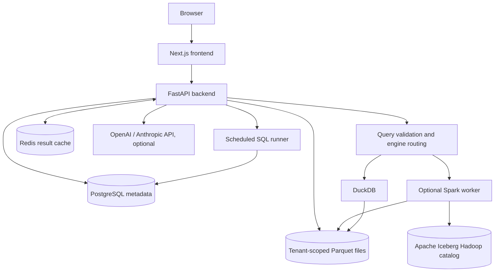

# OpenLake AI — System Architecture

OpenLake AI v0.2.0 is a self-hosted analytics workspace for small teams. It combines a lightweight DuckDB execution path with an optional single-node Spark and Iceberg integration. The current release is a **developer preview**, not a production-hardened multi-tenant service.

## Component diagram

## Query execution

1. A signed-in user submits a SQL statement through the SQL workspace or the REST API.
2. FastAPI identifies the user's organization and resolves only authorized dataset names and files.
3. SQLGlot validates a read-only SELECT query. DuckDB execution disables external file access and registers authorized Arrow tables.
4. In `auto` mode, the router checks the aggregate compressed Parquet storage size for the organization. When Spark is configured and the configured threshold is exceeded, it selects Spark; otherwise it selects DuckDB. This is **not** a cost-based optimizer.
5. If enabled, Redis may return a previously computed bounded result. Cache keys include tenant, query, selected engine, and dataset metadata fingerprints. Cache TTL is 300 seconds.
6. Responses are capped at 500 rows. The DuckDB connection has a 512 MB memory budget. A hard execution-time limit and strong per-tenant compute isolation are **not yet implemented**.

## Storage and Iceberg maintenance

- Uploaded CSV and Parquet datasets are materialized as tenant-scoped local Parquet files on a persistent shared storage volume.
- PostgreSQL holds users, organizations, datasets, saved queries, schedules, and execution history.
- The optional Spark worker can synchronize datasets to Iceberg tables using a local Hadoop catalog. These Iceberg tables live under the shared `/app/storage/iceberg` volume.
- Iceberg binpack maintenance uses `rewrite_data_files` and can be started through the API or through an opt-in periodic policy.
- SQL query execution currently operates on registered Parquet sources; the Iceberg tables are a separate synchronization/maintenance path, **not** the canonical query source. Changes to one are not automatically equivalent to transactional updates in the other.

## Workload scheduling

The backend supports persistent interval-based SQL schedules. A polling loop reads due schedules from PostgreSQL, coordinates with a PostgreSQL advisory lock, executes bounded read-only queries, and stores run statuses. This is a basic built-in scheduler, not a distributed task queue; it does not provide robust retries, quotas, or comprehensive observability.

## AI provider integration

Users can optionally configure their own OpenAI or Anthropic API credentials. Provider keys are encrypted at rest with Fernet and are not returned to the browser. The AI assistant generates reviewable SQL from the user's question and permitted dataset schema. Uploaded data rows are not intentionally sent to the model for SQL generation. Generated SQL must go through the same query validation and authorization layer before execution. Without an API key, non-AI analytics features remain available.

## Security model and boundaries

- Authentication uses an HttpOnly, SameSite=Strict cookie; set `COOKIE_SECURE=true` behind HTTPS.
- Mutating authenticated requests use an origin check (when present) and a CSRF header. Configure the frontend origin and proxy routing carefully.
- Dataset access is scoped by organization in the API and Spark worker; this is application-level isolation rather than separate operating-system or cluster-level tenancy.
- SQL restrictions and a blocklist of external functions are defense-in-depth, not a proof against all hostile queries.
- The Spark worker is intended for a private Docker Compose network. **Do not publicly expose its internal service port.**
- Secrets belong in a noncommitted `.env` file or a production secret manager, never in frontend code or Git history.

## Deployment modes

**Lightweight:** `docker compose up --build -d` for the core FastAPI/Next.js/DuckDB/PostgreSQL/Redis application.

**Hybrid:** Configure `SPARK_URL` and `SPARK_TOKEN` and run `docker compose --profile spark up --build -d`. This adds optional single-node Spark/Iceberg capability with higher memory requirements. See [spark-iceberg.md](spark-iceberg.md) for settings and endpoints.

## Hardening required before customer production use

Use versioned database migrations; container and dependency vulnerability scans; full integration and load testing; independent security review; query cancellation, rate limits and isolation; dedicated background workers, retries and monitoring; backup/restore testing; per-tenant quotas and audit logs; TLS; and appropriate data retention/deletion procedures. For a scalable lakehouse, replace the local Spark worker and shared-filesystem Iceberg catalog with managed cluster orchestration and object storage/catalog services.
